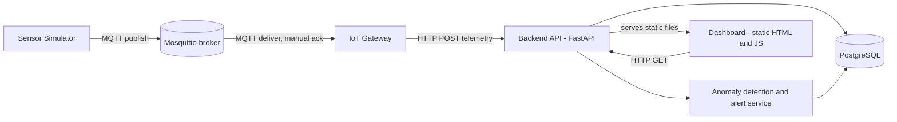

# Industrial Asset Condition Monitoring Platform

[](https://github.com/HTTuong/Industrial_Asset_Monitoring_Platform/actions/workflows/ci.yml)

A simulated industrial IoT platform used to practice quality engineering for distributed, asynchronous systems. Sensors publish telemetry over MQTT, a resilient gateway forwards it to a backend that detects anomalies and raises alerts, and a Robot Framework suite of 59 tests checks the system across API, messaging, browser, failure-injection and concurrency layers.

The interesting part is not the application but the testing: the suite found and documented real defects (silent data loss in the gateway, a hung backend that kills the MQTT thread, race conditions, validation gaps), and the project records each one with evidence, root cause and status.

## Highlights

- **59 automated tests** in 7 Robot Framework groups, plus k6 load scripts.
- **Failure injection against real infrastructure:** stopping the broker, freezing the backend, killing the gateway with readings buffered. The same resilience tests run against local processes and against Docker Compose.
- **Risk-based approach:** every test follows Risk → Expected behavior → Automation, and every finding is tracked in [`docs/risk-analysis.md`](docs/risk-analysis.md).
- **Pinned-defect tests:** known defects are asserted as they currently behave, so the suite stays green and fails loudly with a "looks FIXED" message as soon as a defect is fixed.
- **Containerized stack and CI:** images for backend, gateway and simulator, Compose profiles with healthchecks, and a GitHub Actions workflow that runs 53 of the 59 tests.

## Table of Contents

- [Overview](#overview)
- [Architecture](#architecture)
- [Tech Stack](#tech-stack)
- [Quick Start with Docker](#quick-start-with-docker)
- [Local Development](#local-development)
- [Backend API](#backend-api)
- [Dashboard](#dashboard)
- [Testing](#testing)
- [Continuous Integration](#continuous-integration)
- [Findings](#findings)
- [Project Structure](#project-structure)
- [Documentation](#documentation)
- [Project Status](#project-status)

## Overview

1. **Sensor Simulator** publishes synthetic telemetry (temperature, vibration, battery level) to an MQTT broker.
2. **IoT Gateway** subscribes to the broker and forwards each reading to the Backend API. It acknowledges a message only after the backend answered, buffers and retries while the backend is unreachable, and drops messages that can never succeed.
3. **Backend API** (FastAPI and PostgreSQL) stores devices and telemetry, detects anomalies and raises alerts.
4. **Dashboard** (static HTML and JavaScript) shows devices, telemetry history and active alerts.

The design intentionally mirrors real industrial IoT failure modes: temporary disconnects, delayed delivery, transient versus permanent errors and duplicate delivery. These are the risks the test suite is built to cover.

## Architecture



| Component | Responsibility | Tech |
|---|---|---|
| Sensor Simulator | Publishes synthetic telemetry | Python, `paho-mqtt` |
| MQTT Broker | Message transport, holds unacknowledged messages | Eclipse Mosquitto |
| IoT Gateway | Forwards readings, manual ack, retry buffer, persistent session | Python, `paho-mqtt`, `requests` |
| Backend API | Devices, telemetry, anomaly detection, alerts, serves the dashboard | FastAPI, SQLAlchemy 2.0, Pydantic v2 |
| Database | Persistence | PostgreSQL |
| Dashboard | Read-only view of devices and alerts | HTML, CSS, JavaScript |

**Why a gateway instead of sensor to backend directly?** Real industrial gateways buffer data during connectivity loss and validate payloads before they reach the backend. The gateway here delivers at least once: a reading is acknowledged only after the backend accepted it (or after the gateway deliberately dropped a permanently invalid one). See [`docs/architecture.md`](docs/architecture.md) for the details.

## Tech Stack

- **Backend:** Python, FastAPI, SQLAlchemy 2.0, Pydantic v2, PostgreSQL
- **Gateway and simulator:** Python, `paho-mqtt`, `requests`
- **Message broker:** Eclipse Mosquitto 2
- **Testing:** Robot Framework 7 (RequestsLibrary, Browser library with Playwright, Process library), `pytest` for backend unit tests, k6 for load
- **Infrastructure:** Docker, Docker Compose (profiles and healthchecks), GitHub Actions

## Quick Start with Docker

Prerequisites: Docker and Docker Compose.

**1. Make the broker folders writable** (needed on Linux hosts and in CI so the broker container can write to its bind mounts; harmless on macOS):

```bash
chmod -R 777 mosquitto/data mosquitto/log
```

**2. Start the stack** (broker, database, backend, gateway) and wait until every service is healthy:

```bash
docker compose --profile app up -d --build --wait
```

**3. Register a device.** The backend rejects telemetry for unknown devices with `404`:

```bash
curl -X POST http://localhost:8000/devices \
  -H "Content-Type: application/json" \
  -d '{"device_id": "sensor-001", "name": "Demo sensor"}'
```

**4. Start the simulator** to generate continuous telemetry (one reading every 5 seconds, with a chance of an anomalous value to exercise alerting):

```bash
docker compose --profile app --profile demo up -d
```

**5. Open the dashboard** at [http://localhost:8000/dashboard/](http://localhost:8000/dashboard/).

**Stop everything** (add `-v` to also delete the database volume):

```bash
docker compose --profile app --profile demo down
```

Compose profiles:

| Command | Starts |
|---|---|
| `docker compose up -d` | Mosquitto and PostgreSQL only (for local development) |
| `docker compose --profile app up -d` | adds the backend and the gateway |
| `docker compose --profile app --profile demo up -d` | adds the sensor simulator |

The backend port can be changed with `BACKEND_PORT` (default `8000`). The database credentials in `docker-compose.yml` (`iot_user`, `iot_password`, database `iot_monitoring`) are for local development only.

## Local Development

Run the infrastructure in Docker and the backend and gateway as local processes, which is convenient for debugging. One virtual environment at the repository root serves all services.

```bash
python -m venv venv && source venv/bin/activate
pip install -r services/backend/requirements.txt \
            -r services/gateway/requirements.txt \
            -r services/simulator/requirements.txt
```

Start and stop with the helper script:

```bash
./scripts/dev.sh start     # Mosquitto + PostgreSQL (Docker), backend, gateway
./scripts/dev.sh status    # processes and containers
./scripts/dev.sh logs backend    # or: logs gateway
./scripts/dev.sh stop      # stop backend and gateway
./scripts/dev.sh down      # also stop the Docker services
./scripts/dev.sh restart
```

The backend runs at `http://localhost:8000`. Logs and PID files are written to `.run/`. Run the simulator in a second terminal (register the device first, see step 3 above):

```bash
cd services/simulator && python src/simulator.py
```

**Configuration.** The backend reads `DATABASE_URL`, `MQTT_BROKER_HOST`, `MQTT_BROKER_PORT`, `TEMPERATURE_THRESHOLD` (default 80.0) and `VIBRATION_THRESHOLD` (default 8.0), see [`app/config.py`](services/backend/app/config.py). The gateway and the simulator read `BROKER_HOST` and `BROKER_PORT` (defaults `localhost` and `1883`), and the gateway also reads `BACKEND_URL` (default `http://localhost:8000`). Tables are created on backend startup.

**Run exactly one gateway.** It subscribes to `factory/#` with the fixed MQTT client id `gateway-1`, and a second instance would disconnect the first. The simulator publishes `sensor-001` readings to `factory/line1/sensor-001/telemetry`.

## Backend API

Base URL: `http://localhost:8000`

| Method | Endpoint | Description |
|---|---|---|
| `GET` | `/health` | Liveness check |
| `GET` | `/devices` | List all devices |
| `GET` | `/devices/{device_id}` | Get a single device |
| `POST` | `/devices` | Register a device (`device_id`, `name`). A duplicate `device_id` returns `409` |
| `PATCH` | `/devices/{device_id}/deactivate` | Set a device's status to `inactive` |
| `POST` | `/telemetry` | Ingest a reading and run anomaly detection |
| `GET` | `/telemetry/{device_id}` | Telemetry history for a device (the 50 most recent by default) |
| `GET` | `/alerts` | List alerts, optionally filtered with `?resolved=true` or `?resolved=false` |

**Telemetry rules:** `temperature` must be between -50 and 200, `vibration` must not be negative, and at least one measurement is required. A reading for an unregistered device returns `404`. Known validation gaps (battery range, NaN and Infinity, whitespace in identifiers) are documented as findings below.

**Anomaly detection:** on every reading the backend compares temperature and vibration with the configured thresholds. Exceeding a threshold raises a `high_temperature` or `high_vibration` alert, intended to be deduplicated against an already-open alert of the same type. A later normal reading of the same metric resolves the alert. A device's status changes from `offline` to `active` on its first reading.

## Dashboard

A static dashboard is served at `http://localhost:8000/dashboard/`. The index page shows the **Devices** and **Active Alerts** tables and refreshes every 3 seconds. Clicking a device opens a detail page with its telemetry history and alerts. All dynamic content is rendered with `textContent`, never `innerHTML`, as the fix for the stored XSS finding. Source: [`services/backend/static/`](services/backend/static/).

## Testing

The Robot Framework suite contains 59 tests in 7 groups. The full rationale is in [`docs/test-strategy.md`](docs/test-strategy.md).

| Group | Folder | Tests | Focus |
|---|---|---|---|
| Device management | `robot/tests/device/` | 7 | Register, lifecycle, duplicates, health check |
| MQTT ingestion | `robot/tests/mqtt/` | 11 | Valid and invalid telemetry through broker and gateway |
| End-to-end | `robot/tests/e2e/` | 2 | Dashboard in a real browser |
| Resilience | `robot/tests/resilience/` | 7 | Backend and broker outages, hung backend, gateway crash, poison message, backlog |
| Anomaly and alert | `robot/tests/anomaly_alert/` | 14 | Thresholds, boundaries, alert lifecycle, concurrency |
| Security | `robot/tests/security/` | 5 | Stored XSS on the dashboard |
| Data integrity | `robot/tests/data_integrity/` | 13 | Value ranges, NaN, timestamps, identity, concurrent registration |

### How to read test status

- **Green** normally means the behavior is correct.
- **Pinned defect** (data integrity group): the test asserts that a documented defect is still present, so green means the defect is still there. When the behavior changes, the test fails with a message starting "looks FIXED".
- **Red on purpose** (`alert_concurrency.robot`): the test asserts the correct behavior and fails until the race condition is fixed.

### Setup

```bash
cd robot
python -m venv venv && source venv/bin/activate
pip install -r requirements.txt
rfbrowser init chromium
```

### Run against the Docker stack

Start the stack first (see Quick Start), then from `robot/`:

```bash
robot -d results/ci --variable HEADLESS:True \
  tests/device tests/mqtt tests/e2e tests/data_integrity \
  tests/anomaly_alert/high_temperature.robot \
  tests/anomaly_alert/threshold_boundary.robot \
  tests/anomaly_alert/alert_lifecycle.robot

robot -d results/resilience --variable SERVICE_MODE:docker tests/resilience
```

This is the same selection CI runs. Running `tests` as a whole also includes the security group and the test that is red on purpose.

### Run against local processes

By default (`SERVICE_MODE:process`) the resilience tests start and stop the backend and the gateway as local processes, using `venv/bin/python` at the repository root (see [`robot/resources/variables.resource`](robot/resources/variables.resource)). Create that environment as described in Local Development, run `./scripts/dev.sh start`, then from `robot/` run `robot -d results/local tests/resilience`.

### Backend unit tests

```bash
cd services/backend
pytest
```

These cover the anomaly detection logic: normal readings, threshold breaches, boundary values, missing data and negative values.

### Load tests (k6)

Two k6 scripts live in [`k6/`](k6/): a smoke run and a mixed load that sends telemetry at a constant arrival rate while dashboard viewers read devices and alerts. Install [k6](https://grafana.com/docs/k6/latest/set-up/install-k6/), start the stack, then run from the repository root:

```bash
k6 run k6/smoke.js
k6 run k6/load_mix.js
```

Options are passed as environment variables, for example `k6 run -e RATE=50 -e DURATION=5m -e VIEWERS=20 k6/load_mix.js`. Supported variables: `BASE_URL` (default `http://localhost:8000`), `DEVICES` (default 100), and for the mixed load `RATE` (default 20 per second), `DURATION` (default `2m`) and `VIEWERS` (default 10). The thresholds make k6 exit with code 99 when they are broken. A load baseline has not been recorded yet.

## Continuous Integration

[`.github/workflows/ci.yml`](.github/workflows/ci.yml) runs on pushes to `main` and `master` and on every pull request. It builds the images, starts the stack with `docker compose --profile app up -d --build --wait`, installs the robot dependencies and Chromium, and then runs:

1. the device, MQTT, end-to-end, data integrity and three anomaly files (46 tests),
2. the resilience group in container mode (7 tests), even if the previous step failed.

Reports are uploaded as an artifact, the Compose logs are printed on failure, and the stack is removed with `down -v`. Not in CI yet: the security group, `alert_concurrency.robot` (red on purpose) and k6.

## Findings

A summary of what the tests found. Each entry has evidence, root cause and a suggested fix in [`docs/risk-analysis.md`](docs/risk-analysis.md).

| ID | Finding | Severity | Status |
|---|---|---|---|
| R-GW-01 | Readings buffered in the gateway were lost if it crashed (acknowledged before stored) | High | Fixed |
| R-GW-02 | One permanently rejected reading blocked every reading behind it | High | Fixed |
| R-GW-03 | A hung backend killed the gateway's MQTT thread (silent zombie gateway) | Critical | Fixed |
| R-GW-04 | The gateway buffer has no explicit bound | Low to Medium | Open |
| R-GW-05 | A retried reading can be stored twice (at-least-once delivery) | Medium | Open, accepted trade-off |
| R-AL-01 | Concurrent anomalous readings create duplicate active alerts | Medium | Open, test red on purpose |
| R-SEC-01 | Stored XSS in the dashboard | High | Fix delivered, verification pending |
| R-SEC-02 | No authentication or authorization | High in production | Accepted for this project |
| R-DI-01 to R-DI-06 | Battery range, NaN and Infinity, NaN closing an alert, naive timestamps, whitespace identifiers, concurrent registration returning 500 | Low to High | Open, pinned by tests |
| R-DI-07 | A reading with no measurement was stored as a row of nulls | Medium | Fixed |

## Project Structure

```
.
├── docker-compose.yml           # mosquitto, postgres, backend, gateway, simulator (profiles)
├── .github/workflows/ci.yml     # GitHub Actions workflow
├── scripts/dev.sh               # start/stop helper for local development
├── mosquitto/config/            # MQTT broker configuration
├── docs/
│   ├── architecture.md          # Components, data flow, delivery semantics, deployment
│   ├── risk-analysis.md         # Risk register with evidence and status
│   └── test-strategy.md         # Test groups, techniques, CI, gaps
├── services/
│   ├── backend/
│   │   ├── Dockerfile
│   │   ├── app/                 # main, config, database, models, schemas, anomaly, alert_service, routers/
│   │   ├── static/              # index.html, device-detail.html, dashboard.js, device-detail.js
│   │   └── tests/               # pytest unit tests
│   ├── gateway/                 # Dockerfile, src/gateway.py
│   └── simulator/               # Dockerfile, src/simulator.py
├── robot/
│   ├── libraries/               # Python helpers: MQTT, device simulation, telemetry validation, load, data integrity
│   ├── resources/               # shared variables and keywords (API, MQTT, service control in process and Docker modes)
│   └── tests/
│       ├── device/  mqtt/  e2e/  resilience/
│       └── anomaly_alert/  security/  data_integrity/
└── k6/
    ├── lib/config.js            # shared settings and helpers
    ├── smoke.js                 # smoke run
    └── load_mix.js              # mixed load: ingestion at constant rate plus dashboard viewers
```

## Documentation

- [`docs/architecture.md`](docs/architecture.md): components, data flow, gateway delivery semantics, deployment modes and configuration.
- [`docs/risk-analysis.md`](docs/risk-analysis.md): every finding with severity, evidence, root cause, suggested fix and status.
- [`docs/test-strategy.md`](docs/test-strategy.md): test groups, techniques, execution modes, CI scope and known gaps.

## Project Status

- [x] Architecture, simulator, gateway with at-least-once delivery, backend and dashboard
- [x] Robot Framework suite: 59 tests in 7 groups
- [x] Docker images and Compose profiles with healthchecks
- [x] GitHub Actions CI (53 of 59 tests)
- [x] Architecture, risk analysis and test strategy documents
- [ ] API hardening tests (CORS, Content-Security-Policy, device id format)
- [ ] Security group in CI after the XSS fix is verified on the container stack
- [ ] First recorded k6 run and k6 in CI
- [ ] Fixes for the open defects (left as documented findings on purpose)
