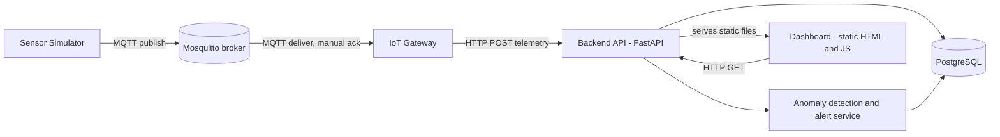

# Architecture of the Industrial Asset Condition Monitoring Platform

## Purpose and scope

This platform simulates industrial IoT asset condition monitoring in the style of a wireless sensor vendor. Sensors publish telemetry over MQTT, a gateway forwards it to a backend API, the backend persists it and raises alerts when thresholds are exceeded, and a small dashboard shows the result. The system exists to be tested: every design choice below was made so that a failure mode (broker down, backend hung, poison message, duplicate delivery) can be provoked and observed from an automated test.

## System overview

## Components

| Component | Responsibility | Technology |
|---|---|---|
| Sensor Simulator | Publishes synthetic telemetry (temperature, vibration, battery) for registered devices | Python, paho-mqtt |
| MQTT Broker | Message transport and the durable store for messages the gateway has not acknowledged | Eclipse Mosquitto |
| IoT Gateway | Consumes telemetry, forwards it to the backend, acknowledges only after a definite outcome | Python, paho-mqtt, requests |
| Backend API | Device registry, telemetry ingestion, anomaly detection, alert lifecycle, serves the dashboard | FastAPI, SQLAlchemy, Pydantic v2 |
| Database | Persistent storage for devices, telemetry readings and alerts | PostgreSQL |
| Dashboard | Read-only view of devices, telemetry history and alerts | Static HTML and vanilla JavaScript served by the backend |

## Data flow

1. A device is registered in the backend through the device API. A second registration of the same `device_id` must be rejected with a conflict (409).
2. The simulator, or a test, publishes a telemetry message on the MQTT broker.
3. The gateway receives the message. It does not acknowledge it yet.
4. The gateway posts the reading to the backend API and classifies the result into one of three outcomes: OK, RETRY or DROP (see the next section).
5. The backend validates the payload, stores the reading and runs anomaly detection against the configured thresholds.
6. If a threshold is exceeded and the device has no unresolved alert of that type, an alert is created. If a later reading of the same metric is back within limits, the unresolved alert is marked resolved.
7. The dashboard reads devices, readings and alerts through the same API.

## Gateway: delivery semantics and failure handling

The gateway is the component that makes the pipeline resilient, and it is the main target of the resilience test group.

- The MQTT session is persistent (`clean_session=False`) and uses the fixed client id `gateway-1`. Messages published while the gateway is offline are queued by the broker and delivered when it reconnects.
- Acknowledgement is manual (`manual_ack=True`). A message is acknowledged only after the gateway knows what happened to it.
- OK: the backend accepted the reading (201). The message is acknowledged.
- RETRY: the backend was unreachable, timed out, or answered 5xx, 408 or 429. The message is not acknowledged, so it stays at the broker. The gateway also keeps it in an in-memory FIFO buffer and retries the head of the queue every 5 seconds. New messages queue behind it so that order is preserved. This is the buffer: nothing is lost while the backend is down.
- DROP: the message is permanently unprocessable (any other 4xx response, or a malformed payload). It is logged and acknowledged, otherwise it would block every reading queued behind it.
- The resulting guarantee is at-least-once delivery. A reading can therefore be stored twice if the backend commits but the acknowledgement is lost (risk R-GW-05).
- No exception may escape into the paho network thread. A callback that raises ends the thread and leaves a gateway that looks alive but consumes nothing (risk R-GW-03), so the callbacks and the retry loop catch everything.
- A second process using the same client id makes the broker disconnect the first one. Exactly one gateway instance may run at a time. The tests rely on this and the CI stack runs a single gateway.

## Backend internals

- `routers/devices.py` registers and deactivates devices and enforces a unique `device_id` through a database constraint.
- `routers/telemetry.py` accepts readings. The schema requires at least one measurement and validates the temperature range (-50 to 200) and a non-negative vibration. Timestamps are generated by the server.
- `anomaly.py` compares the metrics present in a reading with the thresholds from configuration. `alert_service.py` creates and resolves alerts so that at most one unresolved alert exists per device and alert type.
- The dashboard uses two read endpoints: `GET /alerts` (no device filter and no pagination) and `GET /telemetry/{device_id}` (a `limit` parameter, default 50).
- `main.py` exposes `/health`, enables CORS and mounts the static dashboard.
- `config.py` reads settings from environment variables (see Configuration).

## Data model

| Table | Key fields | Notes |
|---|---|---|
| devices | `device_id` (unique), name, status | A deactivated device keeps its history. Telemetry from it does not reactivate it. |
| telemetry | device reference, temperature, vibration, battery, timestamp | At least one measurement is required. |
| alerts | device reference, alert type, `resolved` flag, timestamps | At most one unresolved alert per device and type, enforced in application code only (see R-AL-01). |

## Dashboard

- `index.html` shows the device list and all active alerts.
- `device-detail.html?device_id=X` shows the telemetry history and alerts of one device. It is reached by clicking a `device_id` link in the device list.
- Alert filtering on the detail page is done client-side because the `/alerts` endpoint has no `device_id` query parameter. This is acceptable at the current data volume.
- All dynamic content is written with `textContent` and `createElement`, never `innerHTML`, and the `device_id` in links is passed through `encodeURIComponent`. This is the fix for the stored XSS risk R-SEC-01.

## Deployment modes

| Mode | How it starts | Used for |
|---|---|---|
| Process | `dev.sh` starts backend and gateway as local processes. Broker and database run in Docker. | Fast local development and debugging. |
| Container | `docker compose --profile app up -d --build --wait` | CI and a production-like local run. |

Compose profiles:

- default: Mosquitto and PostgreSQL only.
- `app`: adds the backend and the gateway.
- `demo`: adds the simulator that generates continuous telemetry.

Operational properties of the container stack:

- Every service has a healthcheck: `pg_isready` for PostgreSQL, a `$SYS` subscription for Mosquitto and an HTTP request to `/health` for the backend.
- `depends_on` with `condition: service_healthy` orders startup, and `up --wait` returns only when all services are healthy.
- Images are built from `python:3.13-slim`, the backend and gateway run as a non-root user (uid 10001) and each service has its own `.dockerignore`.
- Every service restarts with `unless-stopped`. Database data lives in the named volume `postgres_data`.
- The robot suite selects the mode with `--variable SERVICE_MODE:process|docker`. In docker mode the resilience tests drive the stack with `docker compose stop`, `pause`, `unpause` and `restart` instead of signalling local processes.

## Configuration

| Variable | Used by | Default | Meaning |
|---|---|---|---|
| `DATABASE_URL` | backend | local PostgreSQL | SQLAlchemy connection string |
| `TEMPERATURE_THRESHOLD` | backend | 80.0 | Temperature above which an alert is raised |
| `VIBRATION_THRESHOLD` | backend | 8.0 | Vibration above which an alert is raised |
| `BROKER_HOST`, `BROKER_PORT` | gateway, simulator | localhost, 1883 | MQTT broker address |
| `BACKEND_URL` | gateway | http://localhost:8000 | Backend base URL |
| `BACKEND_PORT` | compose | 8000 | Host port mapped to the backend |

## Design for testability

- Every boundary is reachable from a test: HTTP for the backend, MQTT for the broker, the database through the API, logs for the gateway.
- Failure injection uses real infrastructure actions (stop the broker, freeze the backend, restart the gateway) rather than mocks, so the tests exercise the same paths production would.
- The gateway logs each delivery outcome (queue size, drops, retries), which lets tests assert on behavior without touching internals.

## Known limitations

These are tracked with evidence and status in `risk-analysis.md`.

- The gateway buffer has no explicit size bound. It relies on the broker's in-flight window and queue limits (R-GW-04).
- Delivery is at-least-once and readings carry no idempotency key (R-GW-05).
- Readings dropped by the gateway are visible only in its log, there is no dead-letter store (R-GW-02).
- The gateway has no liveness signal, so a stuck gateway still looks healthy from outside (R-GW-03).
- Alert creation is a check-then-insert and can race under concurrent readings (R-AL-01).
- Several input validation gaps are pinned as known defects: battery range, non-finite numbers, whitespace in identifiers and naive timestamps (R-DI-01 to R-DI-06).
- CORS allows every origin and no endpoint is authenticated, which is accepted for this simulated environment (R-SEC-02).